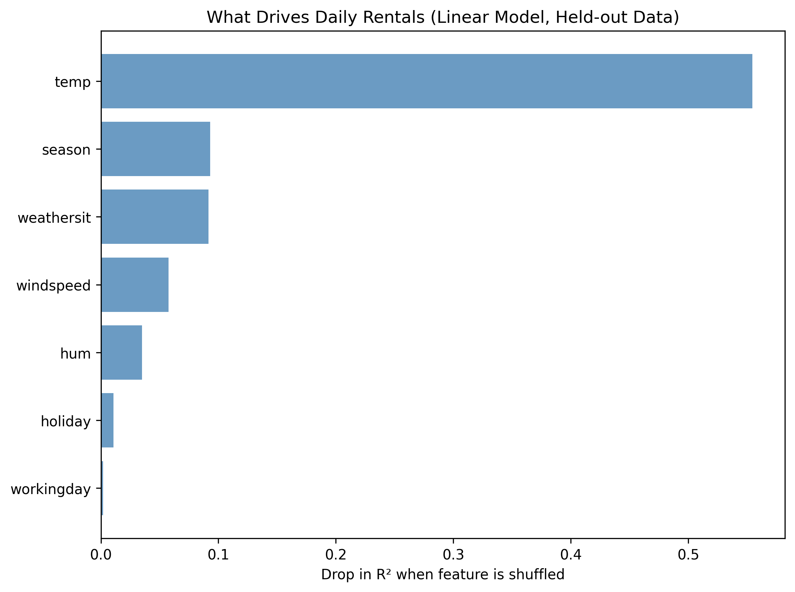
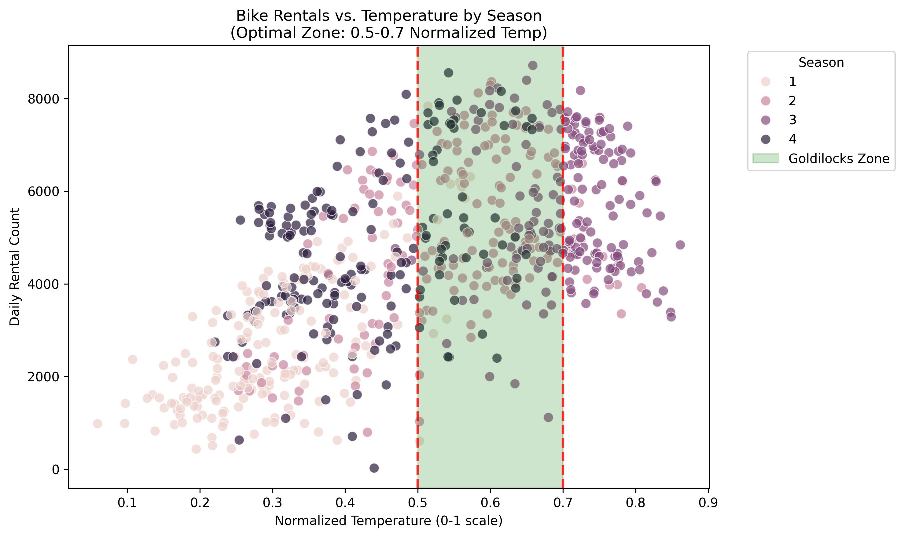

# Optimizing Bike Share Operations Through Data Analytics

[](https://github.com/AbbaAdam1/bike-rental-project/actions/workflows/tests.yml)

This project explores how weather, seasonality, and demand patterns impact daily bike rentals.
Using the [UCI Bike Sharing Dataset](https://archive.ics.uci.edu/ml/datasets/bike+sharing+dataset), the workflow covers data corruption simulation, cleaning, feature engineering, modeling, and visualization to support bike-share operational decisions.

**Tech stack:** Python, pandas, NumPy, scikit-learn, matplotlib, seaborn, unittest, GitHub Actions

## Key Findings
- **Temperature is by far the biggest driver of daily rentals**, followed by season and weather conditions. Wind and humidity matter less, and working days versus weekends barely matter.
- **Rentals peak at about 29°C** (normalized temperature 0.71), at the top of the 0.5–0.7 "Goldilocks Zone".
- **A linear regression model explains 64% of the variation in daily rentals (R² 0.64)** on 6 months of data it never saw, with about 3× lower error than a simple baseline.

<p>
  
  
</p>

## Project Overview
- Goal: Identify factors that influence bike rentals and define optimal conditions for operations.
- Dataset: UCI Bike Sharing Dataset (daily records with weather, season, and rental counts).
- Workflow:
1. Corrupt clean source data in controlled ways (missing values, formatting noise, duplicates).
2. Clean and validate corrupted records with a repeatable pipeline.
3. Engineer useful features (weekend indicator, temperature-humidity interaction).
4. Generate visual outputs for insight communication.
5. Model daily rentals to measure how much each factor matters.

## Project Structure
- `script/produce-file.py`: Generates `day_corrupted.csv` from `day.csv` deterministically.
- `src/bike_rental_pipeline.py`: Core pipeline (cleaning, feature engineering, plotting).
- `src/rental_model.py`: Rental-prediction models, evaluation, and feature importance.
- `bike-rental.py`: Thin entrypoint that runs the pipeline.
- `images/`: Saved figures.
- `tests/test_pipeline.py`: Unit tests for core cleaning/feature logic.
- `tests/test_produce_file.py`: Tests that corrupted-data generation is reproducible.
- `tests/test_rental_model.py`: Tests for the model's features, split, and fit.

## Presentation
- PPT: `presentation/bike_share_analysis.pptx`
- PDF: `presentation/bike_share_analysis.pdf`

## Requirements
- Python 3.10+
- Packages listed in `requirements.txt`

Install dependencies:

```bash
pip install -r requirements.txt
```

## How to Reproduce
1. Generate a corrupted dataset from the clean source:

```bash
python script/produce-file.py
```

2. Run the cleaning and analysis pipeline:

```bash
python bike-rental.py
```

Outputs:
- Cleaned dataset: `day_cleaned.csv`
- Figures: `images/correlation_focused.png`, `images/rentals_vs_temp.png`, `images/rentals_by_season.png`, `images/rentals_by_weather.png`, `images/feature_importance.png`
- Model metrics and top drivers printed to the console

## Modeling Results
The model predicts daily rentals (`cnt`) from weather, season, and calendar features. `casual` and `registered` are excluded because they add up to `cnt`. It trains on days before 2012-07-01 and is tested on the 184 days after, so every score comes from days the model never saw.

| Model | MAE | RMSE | R² |
|---|---|---|---|
| Baseline (training mean) | 2,453 | 2,694 | -1.40 |
| Linear regression | 811 | 1,041 | 0.64 |
| Random forest | 1,123 | 1,302 | 0.44 |

Linear regression is the main model. Rentals grew from 2011 to 2012, and tree models can't predict above the highest values they trained on, so the random forest underestimates the busier test period. Feature importance is measured by shuffling each input on the test days and seeing how much R² drops. The peak temperature comes from the linear model's fitted temperature curve.

## Run Tests

```bash
python -m unittest discover -s tests -p "test_*.py"
```
